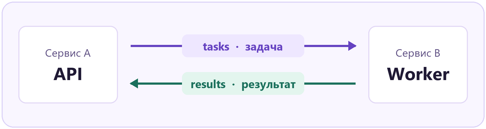
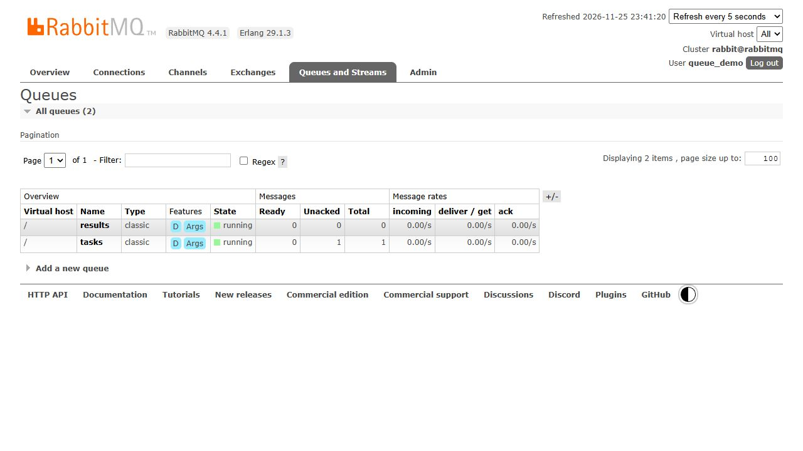

# QueueInteraction · проверка CSV через RabbitMQ

Сервис A принимает CSV по HTTP. Сервис B получает задачу из очереди `tasks`, ждёт 2,5 секунды и считает строки, дубликаты и пропуски. Затем он отправляет `JobCompleted(id, result, completedAt)` в очередь `results`. Сервис A читает событие и сохраняет результат в памяти.

### Маршрут задачи



## Запуск

Запустите Docker с Compose v2 и выполните из корня проекта одну команду:

```bash
docker compose up --build -d --wait
```

- [CSV Lab](http://localhost:8000/) - демонстрационная страница проверки CSV.
- [Swagger UI](http://localhost:8000/docs) позволяет отправить запросы к API вручную.
- [RabbitMQ Management](http://localhost:15672/#/queues) показывает очереди `tasks` и `results`. Логин и пароль - `queue_demo`.
- `docker compose down` останавливает проект. Для следующего запуска используйте ту же команду запуска.

## Проверка в браузере

Откройте [CSV Lab](http://localhost:8000/), нажмите **Подставить пример**, затем **Проверить CSV**. Панель результата сразу покажет `HTTP 202`, время ответа и ID задачи. Через несколько секунд `ACCEPTED` сменится на `DONE`. Для примера получится 4 строки, 1 дубликат и 2 пропуска, по одному в `email` и `city`.

Страницу отдаёт FastAPI. Она вызывает `POST /jobs` и опрашивает `GET /jobs/{id}` каждые полсекунды, пока задача выполняется. По ID задачи можно открыть ответ API. [Снимок страницы с результатом](docs/csv-lab.jpg)

## Запрос через curl

В [examples/job.json](examples/job.json) четыре строки данных, одна повторная строка и по одному пропуску в `email` и `city`. CSV передаётся строкой в поле `csv` и использует запятые как разделители. В заголовке нужны уникальные имена колонок. Пустые строки пропускаются, а пустые ячейки и ячейки из одних пробелов считаются пропусками. Каждое повторение полной строки после первого считается дубликатом.

```bash
reply=$(curl -fsS -w '\nHTTP %{http_code}, %{time_total} s\n' \
  -H 'Content-Type: application/json' --data-binary @examples/job.json \
  http://localhost:8000/jobs)
printf '%s\n' "$reply"
id=$(printf '%s\n' "$reply" | sed -n 's/.*"id":"\([^"]*\)".*/\1/p')

curl -fsS "http://localhost:8000/jobs/$id"; printf '\n'
sleep 3
curl -fsS "http://localhost:8000/jobs/$id"; printf '\n'
```

<details>
<summary>Тот же сценарий в PowerShell</summary>

```powershell
$reply = curl.exe -fsS -w '\nHTTP %{http_code}, %{time_total} s\n' `
  -H 'Content-Type: application/json' --data-binary '@examples/job.json' `
  http://localhost:8000/jobs
$reply
$id = ($reply[0] | ConvertFrom-Json).id

curl.exe -fsS "http://localhost:8000/jobs/$id"
Start-Sleep -Seconds 3
curl.exe -fsS "http://localhost:8000/jobs/$id"
```

</details>

Пример ответа `POST /jobs` и времени запроса:

```text
{"id":"290fb367-27c6-4094-a859-898c8ecc9bcb","status":"ACCEPTED"}
HTTP 202, 0.215 s
```

Сразу после отправки `GET /jobs/{id}` обычно показывает `ACCEPTED`. Через три секунды при свободной очереди тот же запрос вернёт `200 OK` с результатом:

```json
{
  "id": "290fb367-27c6-4094-a859-898c8ecc9bcb",
  "result": {"rows": 4, "duplicateRows": 1, "missingByColumn": {"name": 0, "email": 1, "city": 1}},
  "completedAt": "2026-11-25T10:00:03Z",
  "status": "DONE"
}
```

`202 Accepted` означает, что RabbitMQ подтвердил публикацию задачи. HTTP-запрос завершается до обработки, а заголовок `Location` указывает на адрес для проверки статуса. Некорректный CSV возвращает `422`, неизвестный UUID - `404`. При `503` публикация осталась без подтверждения. Повторный `POST` создаёт новый UUID.

## Что происходит при сбое

Обработчик отправляет ручной `ACK` в `tasks` после того, как RabbitMQ подтверждает публикацию `JobCompleted` в `results`. Если соединение закрывается до `ACK`, брокер возвращает задачу в очередь. Это доставка **at-least-once**. Очереди и сообщения сохраняются на диске RabbitMQ. [Подтверждения в RabbitMQ](https://www.rabbitmq.com/docs/confirms)

Перед публикацией B сохраняет событие в файл по UUID в томе `worker-results`. При повторной доставке B читает этот файл и отправляет то же событие с прежним `completedAt`. Если процесс упал до записи файла, B вычислит результат заново. A применяет только первое событие для известного UUID. При перезапуске A его HTTP-история сбрасывается, поскольку хранится в памяти.

### Демонстрация повторной доставки

1. Включите паузу между публикацией результата и `ACK`.

   ```bash
   DEMO_PAUSE_BEFORE_ACK=60 docker compose up -d --force-recreate worker
   docker compose logs -f worker
   ```

   В PowerShell выполните `$env:DEMO_PAUSE_BEFORE_ACK = '60'` отдельной строкой перед `docker compose up -d --force-recreate worker`.

2. В другом терминале отправьте пример из раздела выше. Дождитесь строки `Result confirmed for …, pausing 60s before ACK`. В RabbitMQ Management у очереди `tasks` будет `Unacked = 1`.

   

3. Завершите B и обновите страницу очередей. У `tasks` будет `Ready = 1` и `Unacked = 0`. API уже может показывать `DONE`, потому что B успел опубликовать событие.

   ```bash
   docker compose kill -s SIGKILL worker
   ```

   

4. Запустите B снова. Логи покажут `redelivered=True`, `Reusing saved result` и `ACK` для того же UUID. Очередь опустеет, а `completedAt` в API сохранится.

   ```bash
   docker compose start worker
   docker compose logs --tail=12 worker
   ```

5. Верните обычный режим командой `DEMO_PAUSE_BEFORE_ACK=0 docker compose up -d --force-recreate worker`. В PowerShell сначала выполните `$env:DEMO_PAUSE_BEFORE_ACK = '0'`, затем `docker compose up -d --force-recreate worker`.
